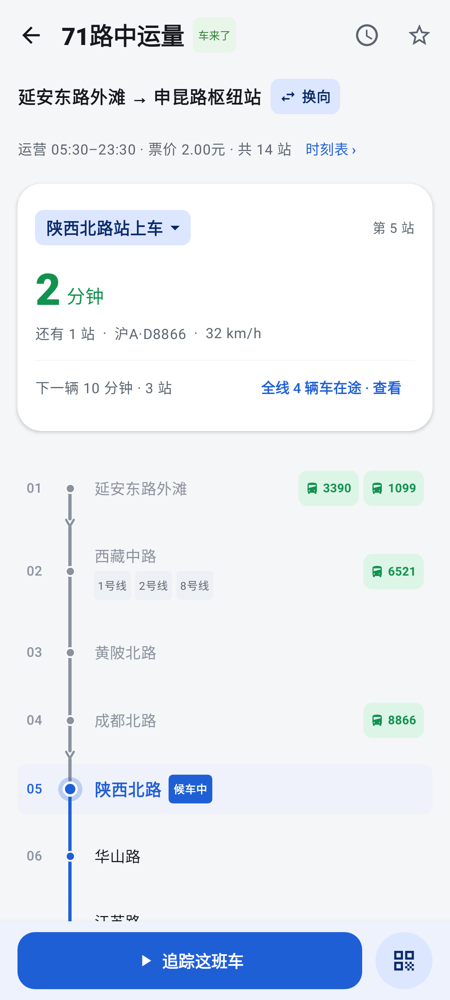
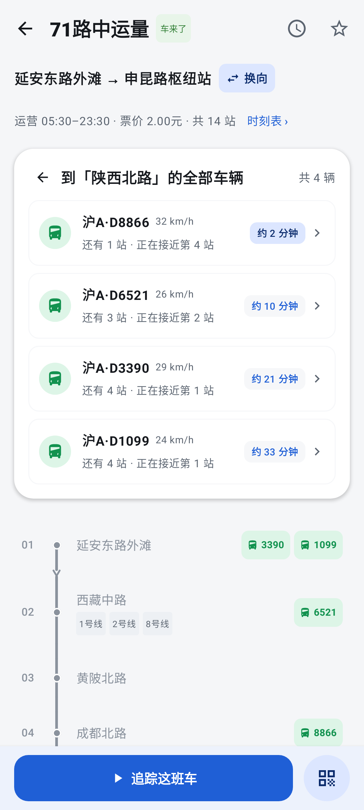
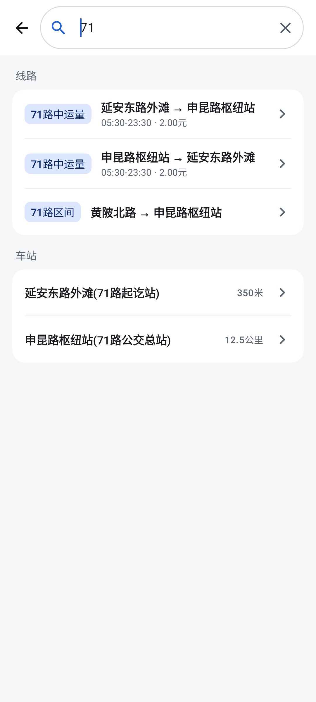
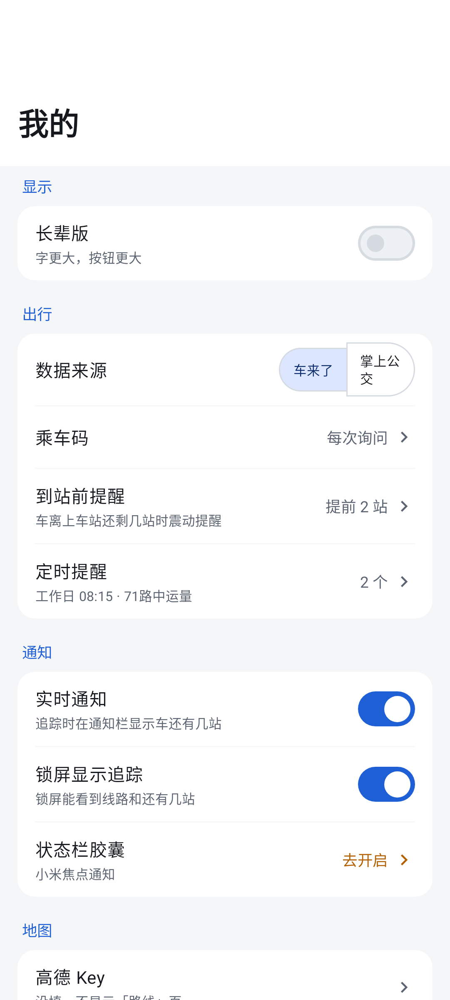
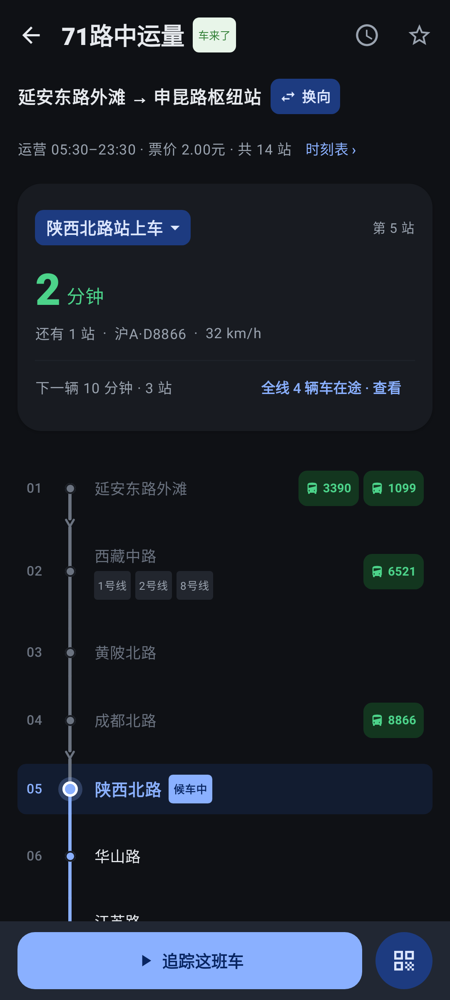

<div align="center">


# 实时公交 · Real-Time Bus（RTBus）

<p align="center">
  <strong>Android 实时公交到站追踪</strong>
</p>

<p align="center">
  <a href="https://developer.android.com">
    
  </a>
  <a href="https://kotlinlang.org">
    
  </a>
  <a href="https://www.jetbrains.com/compose-multiplatform/">
    
  </a>
  <a href="LICENSE">
    
  </a>
</p>

</div>

---

> **RTBus 衍生维护版本**：[本项目 worlt/rtbus](https://github.com/worlt/rtbus) 基于 [上游 Trackr（追客）](https://github.com/5151561/Trackr) 修改，保留原作者及贡献者的 MIT 版权和许可声明。源码、安装包、版本说明及更新清单统一维护在本仓库；[Releases](https://github.com/worlt/rtbus/releases) 提供 APK。应用只检查 RTBus 自己的版本，不检查或安装上游版本，详见下方“检查更新的当前状态”。
>
> 保留原有全国城市选择、切换和查询范围，以及乘车码、小组件、追踪提醒等功能。本页截图仍为上游版本参考，后续以 RTBus 实际验收结果更新。

> **当前版本：0.1.17 / code 25**。源码、Android APK 和默认 / 测试更新清单已统一到本仓库。[下载最新版本](https://github.com/worlt/rtbus/releases/latest) · [更新记录](CHANGELOG.md)。旧版内置更新地址不会自动改写，迁移方法见下方安装说明。

## RTBus 相对上游的主要改动

- **名称与来源**：应用显示名改为“实时公交 / Real-Time Bus”，简称 RTBus；关于页分别提供本项目与上游项目入口，保留原 MIT 版权。
- **移除高德专属能力**：删除地图、起终点提示、公交算路、Key 设置/读写及两端 SDK/专属链接；普通系统定位、全国城市选择与查询、已有收藏路线的文字站序及追踪继续保留。
- **单车乘车提醒**：可指定车辆提醒上车，确认“我已上车”后选择下车站并继续跟踪同车；语音与震动独立控制，保留一起等、定时提醒和后台通知。
- **断网与恢复**：恢复网络后可在首页续查追踪，下拉刷新包含已上车的下车提醒；按追踪会话合并重复刷新。
- **页面交互**：公交 / 我的支持左右滑动，保留各自页面状态；快速切页可从当前画面改向，详情进退与搜索词/键盘恢复已调整，原生提醒弹层支持系统返回。
- **独立更新与公开源码**：源码、APK、稳定 / 测试清单统一在 `worlt/rtbus`；0.1.17 起 App 与发版工具均使用本仓库，不回退上游版本。提供经过 R8 / 资源收缩的 validation 双 ABI 包；历史同签名升级和本次迁移边界分别见 [0.1.16 验收](tasks/update-v17-validation.md) 与 [本次记录](tasks/repository-migration-validation.md)。

乘车码、小组件、收藏/分组、快捷方式、长辈版、主题、KMP/iOS 工程和更新安装校验继续保留。较新手机流畅度与日常功能已获用户反馈；旧手机慢帧排查按用户要求暂停，不能据此宣称全部卡顿已解决。iOS 仍未完成 Xcode 编译和设备验收。

## 📸 界面预览

| 公交首页 | 线路详情 | 在途车辆 | 站点详情 |
| :---: | :---: | :---: | :---: |
| <br/>公交首页 | <br/>线路详情 | <br/>在途车辆 | <br/>站点详情 |
| <br/>搜索 | <br/>我的 | <br/>深色首页 | <br/>深色线路 |

> 全部 11 张截图（含「关于」页和深色版本）见 [截图物料库](screenshots/index.html)。截图由 Robolectric 在 JVM 上按 412 × 915 dp 渲染，不依赖真机。

---

## 📖 项目简介

实时公交（英文名 Real-Time Bus，简称 RTBus）是一款实时公交到站追踪应用，以 Android 为主，iOS 工程复用同一套页面（尚未完成 Xcode / 设备验收，见 [iOS 启动工程](docs/ios.md)）。它把「下一班还有几分钟」放在第一屏，围绕公交、线路、站点和换乘路线组织信息，没有开屏广告，也没有信息流。

应用基于 **Material Design 3 Expressive** 设计，采用 **MAD 分层架构 + Kotlin Multiplatform**：业务页面、状态和 UI 在 `commonMain`，Android / iOS 的平台能力经接口注入。数据来自车来了与掌上公交两个实时数据源，按城市自动选择可用通道。

---

## ✨ 功能

### 公交首页

- **追踪卡片**：正在追踪的线路显示倒计时、剩余站数和「结束」入口；「我已上车」的下车提醒还显示所选车辆的车牌/车号及正在停靠的站或下一站。
- **收藏**：线路、整个站点、换乘路线都能收藏，排在同一个列表里；按上车站展示到站时间，支持排序、分组（可设颜色）和编辑。
- **附近站点**：按距离列出周边站点，直接展开多条线路的到站信息。
- **乘车码**：悬浮按钮一键打开，跟随底部页签收起 / 展开移动。
- **城市切换**：首页标题点开城市列表，切换城市后收藏按城市分开显示。

### 线路与站点

- **线路详情**：横排或竖排走向条，标出每个站的站序、途经车辆和当前候车站；支持换向、时刻表、收藏和开始追踪。可指定一辆未到车辆提醒上车；点“我已上车”选下车站，继续跟踪同一辆车并提醒下车。
- **一起等多条线路**：在站点详情里勾选任意条线路一起等，等车阶段只发一次站点请求；车到站后可以确认「上了哪辆」。
- **到站前提醒**：普通公交线路可设定时通知或到点自动追踪；语音播报与震动分别开关，适用于候车、下车和定时提醒。
- **站点详情**：多物理站台切换、地铁换乘标签、途经线路综合到站看板。

### 收藏路线与高德裁剪状态

- 收藏路线的普通详情、文字站序与追踪入口保留。
- 高德起终点提示、公交算路和地图属于移除范围；路线规划页签和导航入口已关闭，不再注册规划 ViewModel 或 Android SDK 绑定。
- 高德规划/地图 UI、Web 客户端、两端原生 SDK 依赖/链接及 Key 设置/存储与专属隐私流程已删除；普通定位仍使用系统 API。Android release 双 ABI 未签名 APK 已完成构建及产物核查，v16 同签名 validation 包已通过旧手机覆盖升级；独立生产签名发布及 iOS 实际验收尚未完成。

### 搜索与其他

- **搜索**：拼音、汉字模糊匹配，线路按方向一行显示「始发 → 终点」，区分主线和区间车。
- **通知与桌面**：常驻进度通知、到站提醒通知、Glance 桌面微件；小米设备额外适配焦点通知。
- **长辈版**：单列大字号界面，没有底部页签和地图规划；系统字体放大到 2 倍文字也不被裁，按钮不小于 64 dp。
- **主题**：浅色 / 深色可跟随系统或手动选，可换配色风格和主题色。

---

## 🏗️ 工程结构

```text
:androidApp          Android 壳：Activity、追踪服务、通知、桌面微件、系统定位
:composeApp          根 Composable：主题、公交/我的页签、长辈版单栈、NavDisplay、Koin 模块装配；iosMain 是 iOS 宿主入口和平台能力
:core:designsystem   设计系统：颜色、字体、图标、通用文案
:core:model          领域模型（纯 Kotlin）
:core:domain         领域逻辑：到站规则、追踪状态机、坐标换算
:core:network        Ktor 客户端与实时公交数据源
:core:data           仓库实现、追踪会话、收藏合并
:core:database       Room（trackr.db）
:core:datastore      设置与追踪会话存储
:core:navigation     Navigation 3 的页面键与返回栈
:core:ui             多个 feature 共用的组件（乘车码、到站样式、轮询协调）
:core:testing        各仓库的 Fake，供单元测试与截图测试使用
:feature:bus         公交首页
:feature:search      搜索
:feature:stop        站点详情、一起等
:feature:line        线路详情、时刻表
:feature:route       普通路线详情与追踪
:feature:favorites   收藏编辑与分组排序
:feature:me          我的、定时提醒、主题设置、关于
iosApp/              Xcode 宿主（UIKit 薄壳）和 TrackrWidgets 扩展
```

约定：

- UI 走单向数据流：`ViewModel` 暴露 `StateFlow<UiState>`，页面是无状态的 `Screen(state, onEvent)`。
- 功能模块只依赖 `:core:*`，模块之间不互相依赖；跨模块组件下沉到 `:core:ui`。
- Android 专有能力（定位、签名、乘车码、焦点通知）放在 `:androidApp`；`commonMain` 只依赖接口。
- 不同功能的改动分开提交，提交信息沿用 `type(scope): 描述`。

---

## 🛠️ 技术栈

| 模块 | 方案 |
| :--- | :--- |
| 语言 | Kotlin 2.4、Coroutines、Flow |
| UI | Jetpack Compose、Compose Multiplatform 1.12、Material 3 Expressive |
| 导航 | AndroidX Navigation 3（类型安全页面键、每个页签独立返回栈） |
| 依赖注入 | Koin 4.2 |
| 网络 | Ktor 3.6（Android 用 OkHttp 引擎，iOS 用 Darwin）、Kotlinx Serialization |
| 本地存储 | Room 2.8（SQLite）、DataStore Preferences |
| 桌面微件 | Glance 1.2、WorkManager |
| 定位 | Android 系统 LocationManager；iOS Core Location，不依赖地图 SDK |
| 构建 | Gradle 9.8、AGP 9.5、Version Catalogs、约定插件 |
| 性能 | Baseline Profile、Macrobenchmark、Compose 稳定性配置 |
| 测试 | JUnit 4、Robolectric、Turbine、Ktor MockEngine、Jacoco |

---

## 🚀 构建与运行

### 环境要求

- JDK 21
- Android Studio 最新稳定版（需支持 AGP 9.5）
- Android 8.0（API 26）及以上设备
- `compileSdk 37` / `targetSdk 36` / `minSdk 26`

### 常用命令

```bash
# 全量单元测试（验收标准，不需要真机）
./gradlew test

# 只跑某个模块 / 某个测试类
./gradlew :feature:bus:testAndroidHostTest --tests "com.trackr.feature.bus.home.BusHomeViewModelTest"

# 编译并安装 Debug
./gradlew :androidApp:assembleDebug
./gradlew :androidApp:installDebug

# 覆盖率报告
./gradlew jacocoTestReport
```

### 下一版改动（0.1.18，尚未发布）

- 跨城默认先提示确定 / 取消；可在“我的 → 出行 → 跨城切换”改为自动切换或保持当前城市，并记住偏好。启动、下拉刷新或较久后回到首页时检查位置；取消后本次使用不重复询问同一城市。
- 首页滚动较远后，在乘车码按钮上方显示返回顶部；点击只回顶部，不刷新。关闭乘车码后仍可返回顶部，长辈版也支持。
- 本轮仅准备本地同签名验证包，线上下载与更新清单保持下方的 0.1.17；验收见 [本次记录](tasks/city-change-and-scroll-validation.md)。

### 当前 Android 安装包（0.1.17）

多数安卓手机用 **[64 位 APK（arm64-v8a）](https://github.com/worlt/rtbus/releases/download/v0.1.17/RTBus-0.1.17-arm64-v8a.apk)**；只有不支持 64 位的旧机才用 [32 位 APK（armeabi-v7a）](https://github.com/worlt/rtbus/releases/download/v0.1.17/RTBus-0.1.17-armeabi-v7a.apk)。[版本说明和 SHA-256 校验文件](https://github.com/worlt/rtbus/releases/tag/v0.1.17) 与源码统一位于本仓库。

版本为 **0.1.17 / code 25**。沿用现有 `.debug` 安装身份和同一调试证书，validation 变体启用 R8 / 资源收缩、关闭调试与覆盖率插桩，可覆盖既有同签名“实时公交.D”，无需卸载或清数据；它仍不是使用独立生产证书的发行版。双 ABI 均已核验包名、版本、证书、Baseline Profile 和 16 KB 对齐，匿名下载的文件哈希与本地一致。

**旧版迁移**：0.1.14 没有更新源；旧下载仓库已于 2026-11-27 删除，0.1.15 / 0.1.16 内置的旧地址已无法自动检查。请从本节下载新包，同签名覆盖一次；不要卸载或清数据。0.1.17 起通过“我的 → 关于实时公交 → 检查新版本”直接查询本仓库。历史 [0.1.16 真机升级记录](tasks/update-v17-validation.md) 与 [v16 升级记录](tasks/stable-v16-upgrade-validation.md) 保留，新版迁移验证见 [本次记录](tasks/repository-migration-validation.md)。

已收到真实乘车与日常功能可用的反馈，不要求重复同一流程；旧手机慢帧调查继续暂停。原始手机备份、数据库和界面证据仅留本机，不上传。

### 发布 Release

```bash
./gradlew :androidApp:assembleRelease
```

v16 阶段已完成 validation 与常规 release 构建。常规 release 目前没有配置生产签名，输出为以下未签名产物，不能直接安装或覆盖升级：

- `androidApp/build/outputs/apk/release/androidApp-arm64-v8a-release-unsigned.apk`
- `androidApp/build/outputs/apk/release/androidApp-armeabi-v7a-release-unsigned.apk`

可安装的同签名 validation 包见上一节的公开下载链接。后续如接入生产签名，不应将密钥或密码提交到 Git；也不能直接更换现有安装的证书并声称仍可覆盖升级。

iOS 包（未签名，需自行重签）用 Xcode 打包，命令和限制见 [iOS 启动工程](docs/ios.md#打包-ipa)，发布资产命名 `trackr-<版本>-unsigned.ipa`。

### 检查更新的当前状态

- 默认清单为 `https://raw.githubusercontent.com/worlt/rtbus/main/update.json`；启用“接收测试版”后额外查询同目录 `update-beta.json`。无独立测试版时，beta 清单与默认版一致。
- 下载地址只指向本仓库的 RTBus Release；不请求 Trackr 清单、不回退上游，APK 不包含维护者 GitHub 令牌。
- 保留 HTTPS、可信下载地址、按 ABI 选包、包名、递增版本与同证书校验。已在一台 arm64 手机完成 0.1.16 → 0.1.17 的应用内下载 / 系统安装器覆盖升级，新源再次检测为最新，原数据库与设置一致；首轮网络重置及采样边界见 [本次记录](tasks/repository-migration-validation.md)。
- 旧 v16 APK 没有更新源；原独立下载仓库已删除，0.1.15 / 0.1.16 内置的旧源已无法自动发现新版本。请从本仓库 Releases 下载最新 APK 同签名覆盖一次，不要卸载或清数据。推送源码不会自动发布更新，发行需先验证 APK，再提升公开清单，见 [RTBus 更新发行流程](docs/updates.md)。
- GitHub / raw.githubusercontent.com 不可达时可能检查或下载失败；本轮在已连接手机的实际网络成功，不代表所有网络环境均可访问。

### 重新生成 README 截图

```bash
./gradlew :androidApp:testDebugUnitTest --tests "com.trackr.ui.ScreenshotGeneratorTest"
```

产物在 `androidApp/build/screenshots/promo/`，复制到 `screenshots/` 即可。截图测试用 Robolectric 的 native graphics，不启动模拟器。

---

## 高德移除状态

规划页面、地图桥接、规划数据链、Android 全局 SDK 与 iOS CocoaPods/链接已移除；普通公交定位、全国城市查询、收藏路线详情和追踪不依赖高德 Key。

Key 设置入口/页面、仓库、存储读写/迁移、两端运行时装配、专属隐私和构建配置已移除。旧 Key 文件不再读取或创建，Android 的两代备份规则仍排除其历史文件；旧页面标识仅保留序列化兼容，恢复时剔除并保留其他页面。无需配置高德 Key；旧配置/初始化指南不再适用，历史实现可查本地 Git。当前验证结果与未完成验收以 [交接记录](tasks/HANDOFF.md) 为准，不能把 debug 构建或 iOS 静态检查当作发行版/设备验收。

---

## iOS 开发

已提供复用现有 CMP 页面的 Xcode 宿主，打开 `iosApp/Trackr.xcodeproj` 的 Trackr scheme 即可构建。模拟器运行、存储说明和当前能力范围见 [iOS 启动工程](docs/ios.md)。

---

## ⚠️ 免责声明

项目仅用于学习与技术交流。实时公交数据来自第三方公开接口，请遵守数据提供方的服务条款，不要用于商业用途或高频抓取。

---

## 🤝 致谢

本项目在数据协议与接口分析中参考了以下开源项目：

- [yulin-bus-activity](https://github.com/misakano7545/yulin-bus-activity)：双平台 API 参考。
- [chelaile-mcp](https://github.com/PeanutSplash/chelaile-mcp)：车来了数据协议与参数参考。
- [BusFleetTracker-GuiYang-Public-Transit](https://github.com/mage802/BusFleetTracker-GuiYang-Public-Transit)：贵阳公交数据分析与追踪实现参考。

上游已退役的地图与公交算路能力曾由 [高德开放平台](https://lbs.amap.com/) 提供，RTBus 不再使用。

---

## 📄 许可证

本项目采用 [MIT License](LICENSE)。
