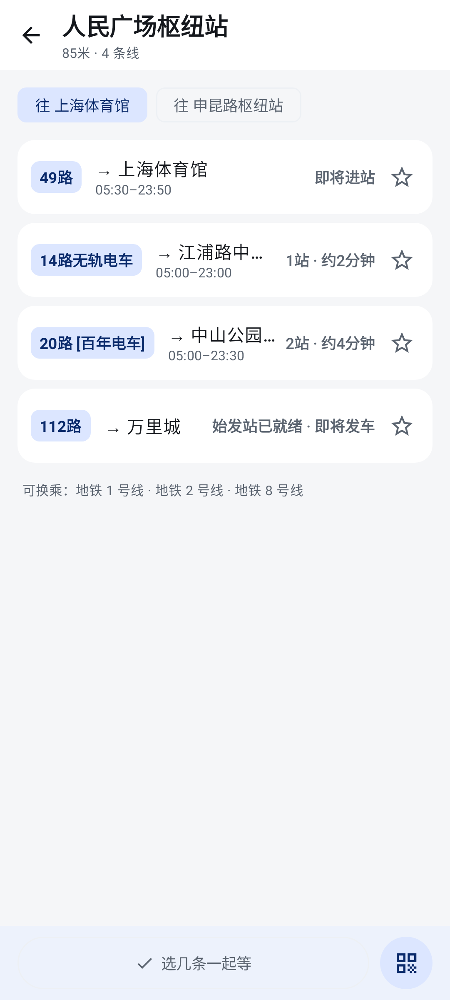
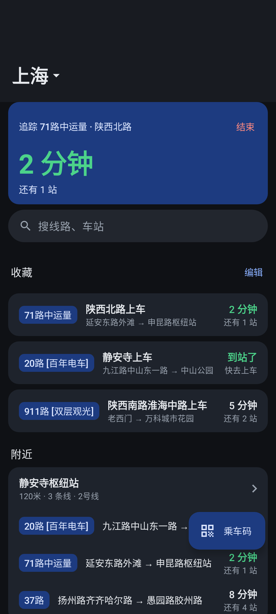

<div align="center">


# 实时公交 · Real-Time Bus（RTBus）

<p align="center">
  <strong>Android 实时公交到站追踪</strong>
</p>

<p align="center">
  <a href="https://developer.android.com">
    
  </a>
  <a href="https://kotlinlang.org">
    
  </a>
  <a href="https://www.jetbrains.com/compose-multiplatform/">
    
  </a>
  <a href="LICENSE">
    
  </a>
</p>

</div>

---

> **本地开发中的衍生项目**：基于 [Trackr（追客）](https://github.com/5151561/Trackr) 修改，保留原作者及贡献者的 MIT 版权和许可声明。当前已完成显示名称调整，已移除高德规划/地图 UI、数据链及两端原生 SDK 依赖/链接；Key 页面/存储、专属隐私及独立更新源仍未完成；暂未发布 RTBus 安装包，不应把上游发行版当作 RTBus。
>
> 保留原有全国城市选择、切换和查询范围，以及乘车码、小组件、追踪提醒等功能。本页截图仍为上游版本参考，后续以 RTBus 实际验收结果更新。

## 📸 界面预览

| 公交首页 | 线路详情 | 在途车辆 | 站点详情 |
| :---: | :---: | :---: | :---: |
| <br/>公交首页 | <br/>线路详情 | <br/>在途车辆 | <br/>站点详情 |
| <br/>搜索 | <br/>我的 | <br/>深色首页 | <br/>深色线路 |

> 全部 11 张截图（含「关于」页和深色版本）见 [截图物料库](screenshots/index.html)。截图由 Robolectric 在 JVM 上按 412 × 915 dp 渲染，不依赖真机。

---

## 📖 项目简介

实时公交（英文名 Real-Time Bus，简称 RTBus）是一款实时公交到站追踪应用，以 Android 为主，iOS 版复用同一套页面（目前只出未签名包，见 [iOS 启动工程](docs/ios.md)）。它把「下一班还有几分钟」放在第一屏，围绕公交、线路、站点和换乘路线组织信息，没有开屏广告，也没有信息流。

应用基于 **Material Design 3 Expressive** 设计，采用 **MAD 分层架构 + Kotlin Multiplatform**：业务页面、状态和 UI 在 `commonMain`，Android / iOS 的平台能力经接口注入。数据来自车来了与掌上公交两个实时数据源，按城市自动选择可用通道。

---

## ✨ 功能

### 公交首页

- **追踪卡片**：正在追踪的线路显示下一班倒计时、剩余站数和「结束」入口，切换页面不丢状态。
- **收藏**：线路、整个站点、换乘路线都能收藏，排在同一个列表里；按上车站展示到站时间，支持排序、分组（可设颜色）和编辑。
- **附近站点**：按距离列出周边站点，直接展开多条线路的到站信息。
- **乘车码**：悬浮按钮一键打开，跟随底部页签收起 / 展开移动。
- **城市切换**：首页标题点开城市列表，切换城市后收藏按城市分开显示。

### 线路与站点

- **线路详情**：横排或竖排走向条，标出每个站的站序、途经车辆和当前候车站；支持换向、时刻表、收藏和开始追踪，也可以只追某一辆车到指定站（下车提醒）。
- **一起等多条线路**：在站点详情里勾选任意条线路一起等，等车阶段只发一次站点请求；车到站后可以确认「上了哪辆」。
- **到站前提醒**：按时间创建定时提醒，到点自动开始追踪，快到站时发通知。
- **站点详情**：多物理站台切换、地铁换乘标签、途经线路综合到站看板。

### 收藏路线与高德裁剪状态

- 收藏路线的普通详情、文字站序与追踪入口保留。
- 高德起终点提示、公交算路和地图属于移除范围；路线规划页签和导航入口已关闭，不再注册规划 ViewModel 或 Android SDK 绑定。
- 高德规划/地图 UI、Web 客户端及两端原生 SDK 依赖/链接已删除；普通定位仍使用系统 API。Key 设置/存储与专属隐私流程待独立清理，release、真机与 iOS 验收尚未完成。

### 搜索与其他

- **搜索**：拼音、汉字模糊匹配，线路按方向一行显示「始发 → 终点」，区分主线和区间车。
- **通知与桌面**：常驻进度通知、到站提醒通知、Glance 桌面微件；小米设备额外适配焦点通知。
- **长辈版**：单列大字号界面，没有底部页签和地图规划；系统字体放大到 2 倍文字也不被裁，按钮不小于 64 dp。
- **主题**：浅色 / 深色可跟随系统或手动选，可换配色风格和主题色。

---

## 🏗️ 工程结构

```text
:androidApp          Android 壳：Activity、追踪服务、通知、桌面微件、定位、高德 Key 存储
:composeApp          根 Composable：主题、3 个页签、长辈版单栈、NavDisplay、Koin 模块装配；iosMain 是 iOS 宿主入口和平台能力
:core:designsystem   设计系统：颜色、字体、图标、通用文案
:core:model          领域模型（纯 Kotlin）
:core:domain         领域逻辑：到站规则、追踪状态机、坐标换算
:core:network        Ktor 客户端、车来了 / 掌上公交 / 高德 Web 接口
:core:data           仓库实现、追踪会话、收藏合并、高德 Key 各槽
:core:database       Room（trackr.db）
:core:datastore      DataStore：设置、高德 Key、追踪会话
:core:navigation     Navigation 3 的页面键与返回栈
:core:ui             多个 feature 共用的组件（乘车码、到站样式、轮询协调）
:core:testing        各仓库的 Fake，供单元测试与截图测试使用
:feature:bus         公交首页
:feature:search      搜索
:feature:stop        站点详情、一起等
:feature:line        线路详情、时刻表
:feature:route       路线规划、路线详情、高德地图
:feature:favorites   收藏编辑与分组排序
:feature:me          我的、定时提醒、高德 Key、主题设置、关于
iosApp/              Xcode 宿主（UIKit 薄壳）和 TrackrWidgets 扩展
```

约定：

- UI 走单向数据流：`ViewModel` 暴露 `StateFlow<UiState>`，页面是无状态的 `Screen(state, onEvent)`。
- 功能模块只依赖 `:core:*`，模块之间不互相依赖；跨模块组件下沉到 `:core:ui`。
- Android 专有能力（定位、签名、乘车码、焦点通知）放在 `:androidApp`，高德地图 SDK 放 `:feature:route` 的 `androidMain`；`commonMain` 只依赖接口。
- 不同功能的改动分开提交，提交信息沿用 `type(scope): 描述`。

---

## 🛠️ 技术栈

| 模块 | 方案 |
| :--- | :--- |
| 语言 | Kotlin 2.4、Coroutines、Flow |
| UI | Jetpack Compose、Compose Multiplatform 1.12、Material 3 Expressive |
| 导航 | AndroidX Navigation 3（类型安全页面键、每个页签独立返回栈） |
| 依赖注入 | Koin 4.2 |
| 网络 | Ktor 3.6（Android 用 OkHttp 引擎，iOS 用 Darwin）、Kotlinx Serialization |
| 本地存储 | Room 2.8（SQLite）、DataStore Preferences |
| 桌面微件 | Glance 1.2、WorkManager |
| 定位 | Android 系统 LocationManager；iOS Core Location，不依赖地图 SDK |
| 构建 | Gradle 9.8、AGP 9.5、Version Catalogs、约定插件 |
| 性能 | Baseline Profile、Macrobenchmark、Compose 稳定性配置 |
| 测试 | JUnit 4、Robolectric、Turbine、Ktor MockEngine、Jacoco |

---

## 🚀 构建与运行

### 环境要求

- JDK 21
- Android Studio 最新稳定版（需支持 AGP 9.5）
- Android 8.0（API 26）及以上设备
- `compileSdk 37` / `targetSdk 36` / `minSdk 26`

### 常用命令

```bash
# 全量单元测试（验收标准，不需要真机）
./gradlew test

# 只跑某个模块 / 某个测试类
./gradlew :feature:bus:testAndroidHostTest --tests "com.trackr.feature.bus.home.BusHomeViewModelTest"

# 编译并安装 Debug
./gradlew :androidApp:assembleDebug
./gradlew :androidApp:installDebug

# 覆盖率报告
./gradlew jacocoTestReport
```

### 发布 Release

```bash
./gradlew :androidApp:assembleRelease
```

按 ABI 出两个包，不合并成一个大包（高德 SDK 的原生库只支持 arm）：

| 产物 | 大小 |
| :--- | :--- |
| `androidApp/build/outputs/apk/release/androidApp-arm64-v8a-release.apk` | 约 47 MB |
| `androidApp/build/outputs/apk/release/androidApp-armeabi-v7a-release.apk` | 约 36 MB |

传到 GitHub Release 时按 `trackr-<版本>-arm64-v8a.apk` / `trackr-<版本>-armeabi-v7a.apk` 命名，应用会按设备架构下载对应包。

iOS 包（未签名，需自行重签）用 Xcode 打包，命令和限制见 [iOS 启动工程](docs/ios.md#打包-ipa)，发布资产命名 `trackr-<版本>-unsigned.ipa`。

### 重新生成 README 截图

```bash
./gradlew :androidApp:testDebugUnitTest --tests "com.trackr.ui.ScreenshotGeneratorTest"
```

产物在 `androidApp/build/screenshots/promo/`，复制到 `screenshots/` 即可。截图测试用 Robolectric 的 native graphics，不启动模拟器。

---

## 高德移除状态

规划页面、地图桥接、规划数据链、Android 全局 SDK 与 iOS CocoaPods/链接已移除；普通公交定位、全国城市查询、收藏路线详情和追踪不依赖高德 Key。

Key 设置页/仓库/旧存储和专属隐私流程仍待下一独立增量清理。无需配置高德 Key；旧配置/初始化指南不再适用，历史实现可查本地 Git。当前验证结果与未完成验收以 [交接记录](tasks/HANDOFF.md) 为准，不能把 debug 构建或 iOS 静态检查当作发行版/设备验收。

---

## iOS 开发

已提供复用现有 CMP 页面的 Xcode 宿主，打开 `iosApp/Trackr.xcodeproj` 的 Trackr scheme 即可构建。模拟器运行、存储说明和当前能力范围见 [iOS 启动工程](docs/ios.md)。

---

## ⚠️ 免责声明

项目仅用于学习与技术交流。实时公交数据来自第三方公开接口，请遵守数据提供方的服务条款，不要用于商业用途或高频抓取。

---

## 🤝 致谢

本项目在数据协议与接口分析中参考了以下开源项目：

- [yulin-bus-activity](https://github.com/misakano7545/yulin-bus-activity)：双平台 API 参考。
- [chelaile-mcp](https://github.com/PeanutSplash/chelaile-mcp)：车来了数据协议与参数参考。
- [BusFleetTracker-GuiYang-Public-Transit](https://github.com/mage802/BusFleetTracker-GuiYang-Public-Transit)：贵阳公交数据分析与追踪实现参考。

上游已退役的地图与公交算路能力曾由 [高德开放平台](https://lbs.amap.com/) 提供，RTBus 不再使用。

---

## 📄 许可证

本项目采用 [MIT License](LICENSE)。

---

## 🌐 友情链接

- [LINUX DO](https://linux.do/) —— 真诚分享、友好讨论的技术社区，本项目的交流与反馈也发布于此。
